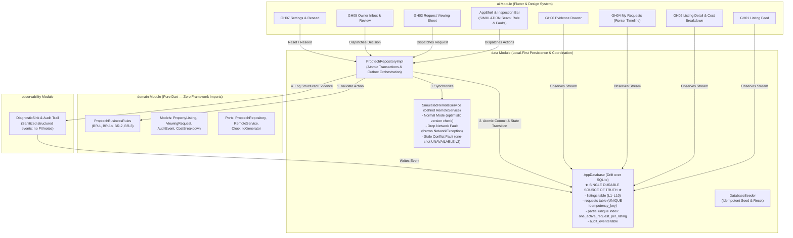

# GharHold Architecture & System Design

GharHold is a local-first, verifiable proptech mobile coordination application built with Flutter and Dart for transparent Mumbai rental discovery.

---

## 1. High-Level Architecture Diagram

---

## 2. Core Operational Flow

The authoritative action loop preserves transactional integrity across every user interaction:

$$\text{UI ACTION} \longrightarrow \text{DOMAIN RULES} \longrightarrow \text{LOCAL TRANSACTION / DRIFT STATE} \longrightarrow \text{SIMULATED REMOTE SYNC} \longrightarrow \text{AUDIT EVIDENCE}$$

1. **Pre-Validation**: `ProptechBusinessRules` validates the proposed action against domain invariants (e.g. checking listing availability, ensuring at most one active request exists, validating note length $\le 200$ chars, requiring non-empty reasons for reopening declined requests).
2. **Local-First Transaction**: On valid commands, Drift executes an atomic transaction that:
   - Updates the listing state (e.g., `AVAILABLE` $\to$ `VIEWING_REQUESTED`).
   - Inserts or updates the request record (with UUID `idempotencyKey` and status `REQUESTED` / `PENDING_SYNC`).
   - Appends a structured `AuditEvent` (`STATE_TRANSITION`).
   If anything fails, SQLite rolls back the entire transaction.
3. **Simulated Remote Synchronization**: The repository dispatches the request through the `RemoteService` port to `SimulatedRemoteService`:
   - **Normal Success**: Remote confirms acceptance; local request sync updates to `SUBMITTED`.
   - **Drop Network Fault**: Throws `NetworkException`. Local database retains the active request in `SYNC_FAILED_RETRYABLE` while keeping the listing locked. Safe retry is exposed to the user reusing the exact same idempotency key.
   - **Stale Conflict Fault**: One-shot fault simulates remote change to `UNAVAILABLE` at version 2. In one transaction, the repository refreshes the listing to authoritative version 2, marks the request `ABORTED` with `CONFLICT_STALE_DATA`, and logs a `CONFLICT` event with client and server versions.
4. **Audit Evidence & Observability**: Diagnostic events are logged with correlation IDs and timestamps. Telemetry strictly sanitizes personal notes and exact addresses.

---

## 3. Module Boundaries & Dependency Inversion

- **`domain`**: 100% pure Dart. Strictly prohibited from importing `package:flutter`, `package:drift`, `sqlite`, or platform/network packages. Verified by `test/domain/domain_purity_test.dart`.
- **`data`**: Implements persistence and remote service adapters behind domain interfaces (`ProptechRepository`, `RemoteService`).
- **`observability`**: Implements structured diagnostics and audit sinks without exposing PII.
- **`ui`**: Flutter UI comprising screens GH01–GH07, theme tokens, and the persistent Architecture Inspection Bar. UI consumes Drift-backed reactive streams without executing business logic directly.

