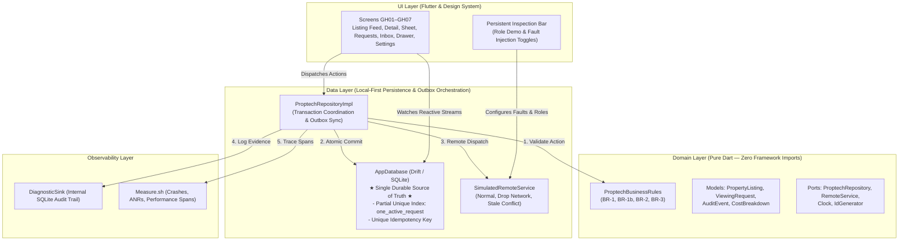
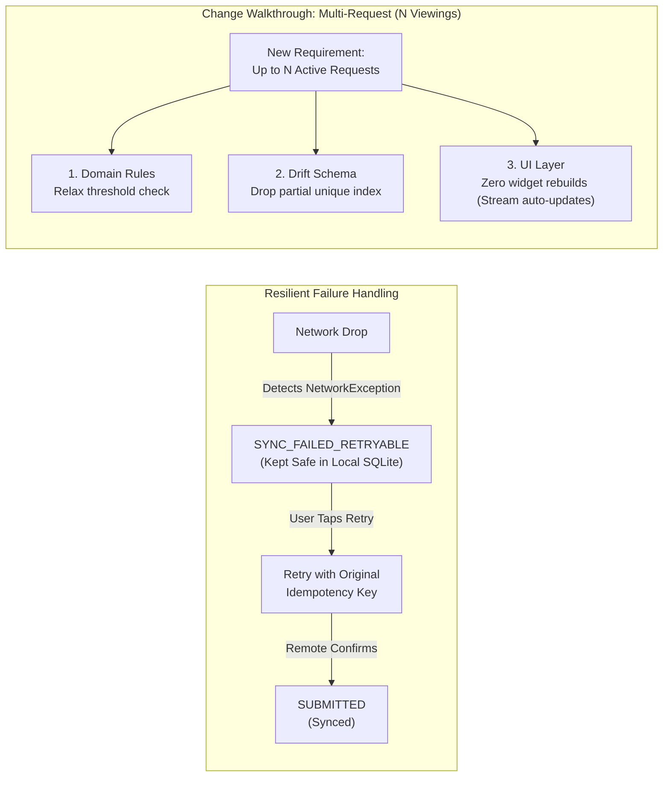

# GharHold Architecture & Solution Presentation Content

**Presentation Title:** GharHold: Verifiable Local-First Proptech Architecture & Solution  
**Target Format:** 16:9 Widescreen (PowerPoint `GHARHOLD_ARCHITECTURE_PRESENTATION.pptx`)  
**Repository:** [Gauravsharma2711/GharHold](https://github.com/Gauravsharma2711/GharHold.git)  
**Authoritative Documents:** `brain.md`, `prd.md`, `system_design.md`, `flow.md`, `ARCHITECTURE.md`

---

## SLIDE 1: One-Page Solution Brief

### 1. Slide Title & Tagline
- **Title:** GharHold: Verifiable Proptech Solution Brief
- **Tagline:** Transparent, Local-First Rental Coordination for Mumbai's Hyper-Competitive Market

### 2. Main Talking Points & Product Overview
- **What is GharHold?**  
  GharHold is a verifiable, local-first mobile proptech prototype designed to eliminate "ghost availability" (advertising vacant flats that have already been leased) and high-stakes double-booking collisions in Mumbai rentals.
- **The Core Problem:**  
  In Mumbai, fast-moving rental markets lead to broken trust: renters rush across the city only to find a flat taken, brokers take multiple informal advance deposits ("tokens"), and mobile connectivity drops during transit causing dropped or duplicate requests.
- **Target Users & Roles:**  
  1. **Renter:** Young professionals/families relocating across Mumbai seeking legitimate viewing slots without competing blind or paying informal unreceipted cash tokens.
  2. **Owner / Landlord:** Flat owners seeking verified, singular tenant commitments without coordinating chaotic parallel inquiries or fielding double-booked slots.

### 3. Core User Journey: Discover → Act → Respond → Track
```
[GH01/GH02: DISCOVER]      [GH03: ACT]              [GH05: RESPOND]        [GH04: TRACK]
Browse Neighbourhood   --> Submit Viewing Request --> Owner Approves or  --> Real-time Timeline &
Approximate Listings        Local Commit + Outbox      Declines with Reason  Hold Status Tracking
```
1. **Discover (GH01/GH02):** Renter browses approximate micromarkets (Powai, Andheri East, Bandra West) and inspects verified move-in cost breakdowns (rent, deposit, brokerage, society fees).
2. **Act (GH03):** Renter selects preferred viewing window and submits request. Domain invariants validate input; Drift commits an atomic local transaction locking the listing into `VIEWING_REQUESTED` before remote sync.
3. **Respond (GH05):** Owner reviews singular inbound request in Owner Inbox, with options to Approve, Decline (with mandatory reason), or Reopen.
4. **Track (GH04):** Renter monitors end-to-end lifecycle on reactive timeline (`REQUESTED` → `APPROVED` → `TOKEN_REQUESTED` → `TOKEN_CONFIRMED`).

### 4. Scope, Assumptions, Constraints & Success Conditions
- **Included Prototype Scope:**
  - 7 screens (GH01–GH07) with Forest-and-Lime design system.
  - Offline-first local SQLite persistence via Drift (`AppDatabase`).
  - Pure Dart domain layer (`lib/domain/`) with zero framework dependencies.
  - Outbox synchronization pattern with deterministic fault injection (`SimulatedRemoteService`).
  - Persistent Architecture Inspection Bar with live demo role switcher and fault injection toggles.
  - Diagnostic Evidence Drawer (GH06) exposing real-time SQLite audit events.
  - Dual observability: Internal SQLite `DiagnosticSink` + Measure.sh mobile telemetry (`ObservabilityService`).
- **Core Assumptions:**
  1. Double-booking and ghost availability can be effectively eliminated at the viewing stage by enforcing a single active request per listing invariant.
  2. The rental token is a binding *commitment hold marker*, not an integrated payment gateway.
- **Technical & Product Constraints:**
  - Prototype executes locally on a single device/emulator without external cloud backend dependencies.
  - Demo Role Switcher is an architectural demonstration seam, not production cryptographic authentication.
  - Strict privacy: No exact street addresses, flat numbers, live GPS, phone numbers, or PII stored or transmitted.
- **Success Conditions:**
  - Zero double-booking incidents (rejection enforced by BR-1 and BR-1b).
  - Zero lost submissions during network drop; 100% safe retry idempotency.
  - Immediate local UI responsiveness (< 16ms render loop).
  - 100% automated test coverage across domain invariants and recovery workflows (54 passing tests).

### 5. Diagram Description: Solution Journey & Guardrails
- **Layout:** 4-step horizontal progression card (Discover → Act → Respond → Track) overlaid with vertical invariant guardrails (BR-1 Availability Guard, SQLite Partial Unique Index, Zero-PII Boundary, Outbox Resilience).

### 6. Implementation References
- Screen implementations: `lib/ui/screens/gh01_listing_feed.dart` through `gh07_settings_reset.dart`
- Design Tokens & Theme: `lib/ui/theme/tokens.dart`, `lib/ui/theme/app_theme.dart`
- Business Invariants: `lib/domain/rules/rules.dart`
- Specifications: `prd.md` (§1–§4), `brain.md` (P0 Scope).

### 7. Speaker Notes
> "Judges, welcome to GharHold. In Mumbai's rental market, finding a home is an exercise in anxiety. Renters battle 'ghost availability'—rushing to view flats already promised to someone else—while owners juggle chaotic WhatsApp threads and multiple uncoordinated tokens. 
> GharHold solves this through a local-first coordination protocol built on four steps: Discover, Act, Respond, and Track. What makes GharHold unique is our uncompromising invariant: at most one active viewing request per listing at any time. 
> Notice how the solution is scoped: we don't need speculative payment rails or live GPS tracking to solve the core trust failure. By capturing local commitments instantaneously on-device and backing them with an atomic SQLite outbox, we eliminate double-bookings before they can ever occur. In the next slide, I'll walk you through how our 4-layer clean architecture guarantees this offline and online."

---

## SLIDE 2: High-Level Design (Architecture & Data Flow)

### 1. Slide Title & Tagline
- **Title:** High-Level Architecture & System Boundaries
- **Tagline:** 4-Layer Clean Architecture with Local-First Persistence and Reactive Data Flows

### 2. Architectural Components & Responsibilities
| Layer / Module | Implementation Path | Framework Coupling | Core Responsibility |
|---|---|---|---|
| **UI Layer** | `lib/ui/` | Flutter, Material 3 | Renders screens GH01–GH07, Design Tokens, Inspection Bar; consumes reactive Drift streams; dispatches user actions without embedding business logic. Wraps sensitive inputs in `MsrMask`. |
| **Domain Layer** | `lib/domain/` | Pure Dart (0 dependencies) | Enforces invariants (BR-1, BR-1b, BR-2, BR-3), entity models (`PropertyListing`, `ViewingRequest`, `AuditEvent`, `CostBreakdown`), and abstract ports (`ProptechRepository`, `RemoteService`, `Clock`, `IdGenerator`). |
| **Data Layer** | `lib/data/` | Drift, SQLite | Single durable source of truth (`AppDatabase`), atomic transactions, partial unique indexing, outbox orchestration (`ProptechRepositoryImpl`), and controllable remote fault simulation (`SimulatedRemoteService`). |
| **Observability** | `lib/observability/` | SQLite + Measure.sh | Dual-system telemetry: Internal `DiagnosticSink` writes structured audit events to SQLite; `ObservabilityService` exports ANR, crash reports, and performance spans with zero-PII masking. |

### 3. Dependencies & Inversion of Control
- `ui` depends on `domain` (models/ports) and `data` (database/repository bindings via `preview_state.dart`).
- `data` implements `domain/ports` (`ProptechRepository`, `RemoteService`).
- `domain` has **zero external imports** (no Flutter, no Drift, no SQLite, no HTTP). Verified by automated test `test/domain/domain_purity_test.dart`.
- `observability` provides decoupled sinks called by repository and UI without interfering with transaction lifecycles.

### 4. Source of Truth & Synchronization Approach
- **Durable Source of Truth:** Local SQLite database accessed via Drift ORM (`AppDatabase`).
- **Reactive UI Streams:** Screens do not maintain isolated widget state; they subscribe to Drift reactive streams (`watchListings()`, `watchRequests()`, `watchAuditEvents()`), guaranteeing instant UI updates upon any database commit.
- **Optimistic Concurrency & Outbox Sync:** Local database commits state transition *before* attempting remote dispatch. Synchronization is managed through `RemoteService` carrying client listing versions for conflict detection.

### 5. High-Level Architecture Diagram


### 6. Implementation References
- `lib/domain/rules/rules.dart` (Pure rules)
- `lib/data/local/database.dart`, `tables.dart` (Drift schema & indexes)
- `lib/data/repository/proptech_repository_impl.dart` (Repository pattern)
- `lib/data/remote/simulated_remote_service.dart` (Remote boundary)
- `lib/observability/diagnostic_sink.dart`, `measure_observability_service.dart`

### 7. Speaker Notes
> "Here is the architectural foundation of GharHold. We follow strict Clean Architecture principles with four distinct modules: UI, Domain, Data, and Observability.
> Notice the critical boundary: our Domain layer is 100% pure Dart. It has zero dependencies on Flutter, Drift, or network libraries. In fact, we run an automated architectural purity test in our CI suite that inspects AST imports to guarantee no framework code ever bleeds into our business logic.
> At the core of the Data layer is SQLite managed via Drift. SQLite is our single, durable source of truth. The UI never mutates state in isolation; all screens subscribe to live, reactive Drift streams. When an action occurs, the repository validates against domain rules, commits the state locally in an atomic SQLite transaction, and only then initiates remote synchronization. Even if the network disappears or the app process is terminated, state integrity is completely preserved."

---

## SLIDE 3: Low-Level Design and Critical Feature (Viewing Request & Outbox Sync)

### 1. Slide Title & Tagline
- **Title:** Low-Level Design: Viewing Request & Local-First Sync
- **Tagline:** Transactional Outbox Pattern, Partial Unique Indexing, and Optimistic Concurrency

### 2. Relevant Classes, Interfaces & Entities
- **Domain Interfaces:** `ProptechRepository` (`lib/domain/ports/proptech_repository.dart`), `RemoteService` (`lib/domain/ports/remote_service.dart`).
- **Core Entities:**
  - `PropertyListing`: `id`, `title`, `state` (`ListingState`), `version`, `rent`, `deposit`, `neighbourhood`.
  - `ViewingRequest`: `id`, `idempotencyKey`, `listingId`, `renterId`, `status` (`RequestStatus`), `syncState` (`SyncState`), `clientListingVersion`.
  - `AuditEvent`: `timestamp`, `correlationId`, `component`, `eventType`, `previousState`, `newState`, `ruleOrErrorCode`.
- **Primary Methods:**
  - `ProptechBusinessRules.validateNewViewingRequest()`
  - `ProptechRepositoryImpl.submitViewingRequest()`
  - `ProptechRepositoryImpl.retrySync()`
  - `AppDatabase.transaction()`

### 3. State Machines & Enums
- **Listing States:** `AVAILABLE` → `VIEWING_REQUESTED` → `TOKEN_LOCKED` → `UNAVAILABLE`.
- **Request Statuses:** `REQUESTED` → `APPROVED` → `TOKEN_REQUESTED` → `TOKEN_CONFIRMED` (or `DECLINED` / `ABORTED` / `REOPENED`).
- **Sync States:** `PENDING_SYNC` → `SUBMITTED` (or `SYNC_FAILED_RETRYABLE` / `CONFLICT_STALE_DATA`).

### 4. Step-by-Step Execution Sequence (The 10-Step Workflow)
1. **Renter Action:** User selects available listing (e.g. `L01`) in GH01/GH02, opens GH03 Request Viewing Sheet.
2. **Form Submission:** User chooses preferred window (`Tomorrow Evening`), types optional note, taps *Request Viewing*.
3. **Domain Validation:** `ProptechBusinessRules.validateNewViewingRequest()` validates:
   - BR-1: Listing state must be `AVAILABLE`.
   - BR-1b: Listing must have no active requests (`activeRequestStatuses = {REQUESTED, APPROVED, REOPENED, TOKEN_REQUESTED, TOKEN_CONFIRMED}`).
   - BR-2: Note length $\le 200$ trimmed characters.
   - BR-3: Actor role must be `Role.RENTER`.
4. **Active Request Check:** Repository queries `requests` table where `listing_id = ?` to verify zero active records.
5. **Idempotency Generation:** Repository generates UUID `requestId` and unique `idempotencyKey` once.
6. **Atomic SQLite Transaction:** In a single atomic commit:
   - Listing state transitions: `AVAILABLE` → `VIEWING_REQUESTED`.
   - New request inserted: status `REQUESTED`, syncState `PENDING_SYNC`.
   - State transition audit event appended to `audit_events`.
   - *Database Partial Unique Index (`one_active_request_per_listing`) guarantees collision prevention at SQLite engine level.*
7. **Remote Sync Attempt:** Repository calls `remoteService.submitViewingRequest(newRequest, listing.version)`.
8. **Success Path:** Remote accepts; local request updates to `SUBMITTED`; `STATE_TRANSITION` audit event recorded.
9. **Network Failure Path:** If remote throws `NetworkException`, request updates to `SYNC_FAILED_RETRYABLE`. The listing remains safely locked in `VIEWING_REQUESTED`. No data is lost.
10. **Safe Retry Path:** User taps *Retry* in GH04. `retrySync()` executes remote call reusing the **exact original idempotency key**. Remote recognizes existing submission or commits without duplicating rows.

### 5. Sequence Diagram
```mermaid
sequenceDiagram
    autonumber
    actor Renter as Renter (GH03)
    participant Repo as ProptechRepositoryImpl
    participant Rules as ProptechBusinessRules
    participant DB as AppDatabase (SQLite)
    participant Remote as SimulatedRemoteService
    participant Sink as DiagnosticSink

    Renter->>Repo: submitViewingRequest(listingId, window, note)
    Repo->>Rules: validateNewViewingRequest(listing, hasActive, note)
    Rules-->>Repo: Valid()
    Note over Repo,DB: Step 6: Atomic SQLite Transaction
    Repo->>DB: BEGIN TRANSACTION
    Repo->>DB: UPDATE listings SET state = 'VIEWING_REQUESTED'
    Repo->>DB: INSERT INTO requests (id, idempotencyKey, status='REQUESTED', sync='PENDING_SYNC')
    Repo->>DB: INSERT INTO audit_events (STATE_TRANSITION)
    Repo->>DB: COMMIT TRANSACTION
    Repo-->>Renter: UI updates immediately via Drift Stream
    
    alt Remote Sync Success
        Repo->>Remote: submitViewingRequest(request, clientVersion)
        Remote-->>Repo: Acknowledged (200 OK)
        Repo->>DB: UPDATE requests SET sync = 'SUBMITTED'
        Repo->>Sink: Log STATE_TRANSITION (SUBMITTED)
    else Network Failure (Fault Injected)
        Repo->>Remote: submitViewingRequest(...)
        Remote-->>Repo: throws NetworkException
        Repo->>DB: UPDATE requests SET sync = 'SYNC_FAILED_RETRYABLE'
        Repo->>Sink: Log SYNC_FAILURE (ERR_NETWORK_DROP)
        Repo-->>Renter: Displays Recovery Banner with Retry CTA
        Renter->>Repo: retrySync(requestId)
        Repo->>Remote: submitViewingRequest(same request & idempotencyKey)
        Remote-->>Repo: Success
        Repo->>DB: UPDATE requests SET sync = 'SUBMITTED'
    else Stale Version Conflict (Concurrent Update)
        Repo->>Remote: submitViewingRequest(clientVersion=1)
        Remote-->>Repo: throws StaleVersionConflict(serverVersion=2, UNAVAILABLE)
        Repo->>DB: BEGIN TRANSACTION
        Repo->>DB: UPDATE listings SET state = 'UNAVAILABLE', version = 2
        Repo->>DB: UPDATE requests SET status = 'ABORTED', sync = 'CONFLICT_STALE_DATA'
        Repo->>Sink: Log CONFLICT (v1 -> v2)
        Repo->>DB: COMMIT TRANSACTION
        Repo-->>Renter: Explains listing taken; aborts request cleanly
    end
```

### 6. Implementation References
- `lib/data/repository/proptech_repository_impl.dart` (lines 121–344)
- `lib/domain/rules/rules.dart` (lines 80–135)
- `lib/data/local/tables.dart` (lines 45–65, partial unique index definition)

### 7. Speaker Notes
> "Let's dive into the core technical engine: the Viewing Request and Outbox Synchronization workflow.
> Look at the sequence diagram on this slide. Most naive mobile apps make an HTTP POST request first, wait for a spinner, and if the network drops on the Mumbai metro, the user double-taps and creates duplicate bookings.
> GharHold reverses this. When the renter taps 'Request Viewing', we first run our pure domain rules. Then, we execute an atomic SQLite transaction via Drift. In that single transaction, we update the listing to `VIEWING_REQUESTED`, insert the request record with a unique UUID idempotency key, and write a structured audit event. Even if the network drops instantly, the request is permanently stored on the device.
> Notice our dual safety net: we don't just rely on application logic. In our SQLite schema, we enforce a database partial unique index on `requests(listing_id)` for active statuses. This guarantees at the database storage engine level that two active requests can never co-exist for the same property.
> When synchronization fails, we move the request to `SYNC_FAILED_RETRYABLE`. The user is shown a clear recovery banner, and when they tap Retry, we reuse the exact same idempotency key—guaranteeing zero duplicate rows on the server."

---

## SLIDE 4: Architectural Decision Records (ADRs)

### 1. Slide Title & Tagline
- **Title:** Architectural Decision Records (ADRs) & Trade-offs
- **Tagline:** Rigorous Trade-off Analysis Across All 8 Key System Dimensions

### 2. Compact Decision Matrix (All 8 Decision Areas)

| # | Decision Area | Status | Context & Problem | Chosen Decision | Evaluated Alternatives | Technical Rationale & Trade-off | Reconsideration Trigger |
|---|---|---|---|---|---|---|---|
| **1** | **Local-First Persistence & Outbox** | **Implemented** (ADR-001) | Network flakiness during transit causes dropped requests and duplicate holds. | SQLite via Drift as single source of truth; local transaction before remote sync. | Direct HTTP REST, in-memory caching, CouchDB/Firebase. | Guarantees instant UI responsiveness and offline survivability. Trade-off: Requires local outbox queue management. | Transition to real distributed multi-master cloud backend. |
| **2** | **Pure Domain State Machines** | **Implemented** (ADR-002) | Complex inventory states require strict validation against illegal business leaps. | Pure Dart domain layer with zero framework dependencies (rules, models, ports). | Placing validation in UI widgets, state notifiers, or SQL triggers. | Decoupled, deterministic, testable in milliseconds. Zero framework lock-in. | Business requirements requiring backend-orchestrated dynamic workflows. |
| **3** | **Single Active Request per Listing** | **Implemented** (BR-1b) | Double-booking and ghost availability destroy renter-owner trust in Mumbai. | At most 1 active request per listing enforced via domain rules + DB partial unique index. | Multi-tenant waitlists, first-to-pay auctions, manual owner triage. | Completely eliminates race conditions and ghost holds. Trade-off: Other renters must wait until slot is resolved. | Requirement for open open-house viewing queues or batch viewings. |
| **4** | **Remote Service Boundary & Faults** | **Implemented / Simulated** (ADR-002) | Testing offline recovery and stale conflicts on a single device during evaluation. | `RemoteService` port with `SimulatedRemoteService` offering controllable faults. | Mockito test mocks, live cloud API backend, manual airplane mode. | Deterministic, reproducible hackathon evaluation without external cloud dependencies. | Transitioning to live production REST/gRPC backend. |
| **5** | **Structured Observability & Audits** | **Implemented** | Need to verify internal state transitions while monitoring technical app health. | Dual pipeline: Internal SQLite `DiagnosticSink` (GH06) + Measure.sh SDK. | Single console logging, raw Firebase Analytics, Sentry only. | Separates durable business auditability from operational telemetry; zero PII leakage. | Centralized regulatory compliance logging requirements. |
| **6** | **Privacy, Security & Scope** | **Implemented** | Tenant safety, location security, and avoiding hackathon credential leaks. | Approximate neighbourhoods only (no GPS/exact address); zero secrets in repo; `MsrMask`. | Full Google Maps integration, precise flat numbers, real payment rails. | Eliminates stalker risk and protects renter privacy while keeping prototype cloud-independent. | Commercial launch requiring Aadhaar KYC and property title verification. |
| **7** | **Repository Pattern & UI Separation** | **Implemented** | UI widgets coupling directly to SQLite tables or network clients. | `ProptechRepository` port exposing reactive streams; UI consumes streams only. | Direct database queries in Flutter State, global service locators. | Clean testability; state survives widget rebuilds; UI has zero SQL knowledge. | Micro-frontend or multi-platform native rewrites. |
| **8** | **AI Assistance & Deterministic Fallback** | **Planned / Architectural** (PRD Bonus B) | Move-in cost complexity requires plain-English explanations without hallucinated figures. | Domain calculates numbers deterministically (`CostBreakdown`); LLM only explains. Fallback on timeout. | Allowing LLM to generate lease figures directly, static FAQ text. | Strict division of labor: deterministic math + cognitive summary with safe fallback. | Implementation of external LLM API gateway in production phase. |

### 3. Implementation Evidence & Test Coverage
- ADR Documentation: `docs/adr/ADR-001.md`, `docs/adr/ADR-002.md`
- Security Baseline: `docs/security-baseline.md` (0 secrets, zero PII)
- Observability Catalog: `docs/observability-events.md`
- Purity Verification: `test/domain/domain_purity_test.dart` (enforces zero imports in domain)
- Total Test Suite: 54 automated unit, domain, repository, recovery, and widget tests passing green.

### 4. Speaker Notes
> "On Slide 4, we present our Architectural Decision Records. Good architecture is defined by the quality of its trade-offs. Here we document all eight core decisions.
> Let's highlight three critical choices:
> First, Decision 1: Local-First Outbox. Rather than treating mobile as a thin client to a cloud server, Drift/SQLite is our single source of truth. The UI updates in zero milliseconds because it reads from local streams.
> Second, Decision 3: Single Active Request. We chose a strict partial unique index on the database table. Even if a bug were introduced in the Flutter UI, SQLite itself physically rejects any attempt to insert a second active request on an occupied listing.
> Third, look at Decision 8: AI Assistance. Notice how we approach AI responsibly: our architecture mandates that pure Dart domain logic deterministically calculates every rupee of rent, deposit, and stamp duty. If an LLM is introduced to provide plain-language explanations, it is strictly isolated to an explanatory advisory role. If the model times out or hallucinates, the system falls back instantly to deterministic math. This is how proptech software should be built."

---

## SLIDE 5: Core, Failure, and Change Walkthroughs

### 1. Slide Title & Tagline
- **Title:** System Walkthroughs: Resilience & Evolution
- **Tagline:** Verification Across Normal Execution, Extreme Failure Modes, and Requirements Evolution

### 2. Part A: Expected Behavior (The Happy Path)
- **Normal Journey:** Renter selects `L01` (Powai 2BHK) → Submits viewing request → Domain validates → SQLite commits `VIEWING_REQUESTED` + `REQUESTED (PENDING_SYNC)` → `SimulatedRemoteService` simulates 500ms network latency → Remote confirms → Local record transitions to `SUBMITTED` → Owner opens GH05 Inbox → Taps *Approve* → Invariant transitions request to `APPROVED` and listing advances toward token hold readiness.
- **Diagnostics Recorded:** `STATE_TRANSITION` (Available → Requested), `STATE_TRANSITION` (Pending → Submitted), `OWNER_DECISION` (Requested → Approved).

### 3. Part B: Comprehensive Failure Modes & Recovery Matrix

| Failure Mode | Root Cause / Trigger | System Detection | User Experience & UI Representation | Diagnostic Evidence Recorded | Recovery & Resolution |
|---|---|---|---|---|---|
| **1. Network Drop** | Packet drop or flaky transit network during outbox sync. | `SimulatedRemoteService` throws `NetworkException`. | Request displays in GH04 with amber badge: **"Saved on this device — sync pending"** + *Retry* button. | `SYNC_FAILURE` event (`ERR_NETWORK_DROP`) logged in SQLite. | User taps *Retry*; repository resends with **identical idempotency key**; transitions to `SUBMITTED`. |
| **2. Duplicate Submission** | Double-tapping submit button or repeated retry attempts. | SQLite `UNIQUE(idempotency_key)` constraint. | UI suppresses duplicate click; existing request state maintained; zero duplicate cards. | Second attempt rejected at repository level; zero extra rows. | Idempotency key guarantees exactly-once semantics. |
| **3. Stale-Version Conflict** | Listing taken remotely while renter was viewing outdated local cache. | Remote service compares `clientListingVersion` (v1) with server version (v2). | GH04 request marked **"Aborted — Listing Unavailable"**; GH02 detail updates to `UNAVAILABLE`. | `CONFLICT` event logged with `v1 (AVAILABLE) -> v2 (UNAVAILABLE)` and `ERR_STALE_VERSION`. | Client transactionally updates listing to v2 and aborts stale request; prevents ghost viewing. |
| **4. Invalid State Transition** | Attempting illegal transition (e.g. approving a declined request without reopening). | `ProptechBusinessRules` validates state machine before DB query. | Immediate validation error message: "Declined requests must be reopened with a reason." | `RULE_REJECTED` event logged with `ruleOrErrorCode = ERR_INVALID_TRANSITION`. | Action blocked; database state completely untouched. |
| **5. App Crash / Interruption During Sync** | OS terminates app process while request is in `PENDING_SYNC`. | `ProptechRepository.runStartupRecovery()` executes on app initialization. | On restart, GH04 shows request in `SYNC_FAILED_RETRYABLE` with Recovery Banner. Never lost! | `RESUME_SCAN` event logged in `audit_events` with recovered request ID. | User can review and tap *Retry* when connectivity is restored; never silently dropped. |

### 4. Part C: Change Walkthrough (Requirements Evolution)
- **Hypothetical Requirement Change:** *"GharHold must support up to $N$ concurrent viewing requests per listing in a future version (Queue / Batch Viewings)."*
- **Why the Architecture Absorbs This Change Gracefully:**
  1. **Domain Layer:** Only `ProptechBusinessRules.validateNewViewingRequest()` and `activeRequestStatuses` set change. We update invariant check from `hasActiveRequest` to `activeRequestCount < maxAllowed (N)`.
  2. **Data / Database Layer:** We drop or modify the SQLite partial unique index `one_active_request_per_listing` via a Drift schema migration, replacing it with a queue position column or composite counter.
  3. **Repository Layer:** `submitViewingRequest()` assigns an incrementing `queuePosition` within the listing lock transaction.
  4. **UI Layer:** GH01–GH03 remain identical. GH04 My Requests displays *"Viewing Queue: Position 2 of 3"*. GH05 Owner Inbox renders a prioritized candidate list.
  5. **Observability & Tests:** Audit sinks already record previous $\to$ new states seamlessly; we update unit tests for the $N$-request threshold.
- **Key Architectural Benefit:** The separation between pure Domain rules, Drift persistence, and reactive UI streams means **0% of the UI widgets need to be rewritten**—only the domain rule and database index change!

### 5. Diagram: Failure Recovery Flowchart & Change Impact


### 6. Implementation References
- Error handling & retry: `lib/data/repository/proptech_repository_impl.dart` (lines 262–344, 347–430)
- Startup recovery scan: `lib/data/repository/proptech_repository_impl.dart` (lines 760–801)
- Automated verification: `test/data/recovery_test.dart`, `test/domain/rules_test.dart`

### 7. Speaker Notes
> "Finally, Slide 5 proves the operational resilience and evolvability of GharHold.
> In Section B, look at how we handle every failure mode. Take network failure: when a packet drops in a basement or train station, our outbox catches it, marks the request `SYNC_FAILED_RETRYABLE`, and displays a clear recovery banner. The request is safe in local SQLite. On retry, the exact original idempotency key is reused, preventing duplicates. 
> Even more impressive is startup recovery: if the OS kills the app while a request is pending sync, our repository runs a startup recovery scan on launch. It locates the orphaned record, marks it retryable, logs a `RESUME_SCAN` audit event, and alerts the user. A transaction is never silently dropped.
> In Section C, we address the ultimate test of software architecture: how easily does it adapt to change? If business stakeholders ask us tomorrow to support multiple active viewing requests instead of one, look at our change-impact map. Because our domain rules are strictly separated from UI and database storage, we only modify a single rule method and a database constraint. The UI widgets and reactive streams require zero rewrites. That is the power of verifiable Clean Architecture."

---
*End of Presentation Content Document.*
