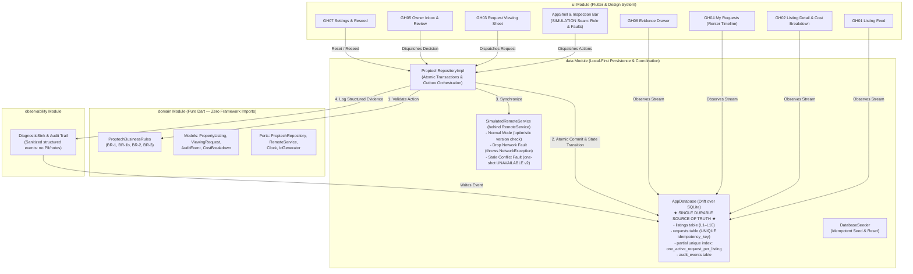

# GharHold — Transparent Proptech Coordination for Mumbai Rentals

> **A verifiable, local-first Flutter application solving Mumbai's rental double-commitment and ghost-availability crisis through deterministic state machines, durable SQLite persistence, and outbox synchronization.**

[](https://github.com/Gauravsharma2711/GharHold/actions/workflows/ci.yml)
[](https://flutter.dev)
[](https://dart.dev)
[](https://drift.simonbinder.eu/)
[](file:///docs/test-evidence.md)
[](https://opensource.org/licenses/MIT)

---

## 1. The Mumbai Rental Problem & Headline Rule

### The Crisis: Ghost Availability & Double Commitments
In high-velocity Mumbai residential micromarkets (Powai, Bandra West, Andheri East, Malad West), rental flats receive multiple viewing requests simultaneously. Brokers and landlords routinely promise the same flat to multiple prospective tenants, collect informal non-refundable "holding cash", and leave renters stranded when a flat abruptly vanishes ("ghost availability"). 

During commutes through the Mumbai Suburban Railway and metro corridors, intermittent cellular connectivity frequently causes mobile submissions to drop or double-fire, resulting in duplicate commitments, lost records, and confusing UI states.

### The Headline Business Rule
> **A rental listing can have at most ONE active viewing or token request at any given time.**
> While an active request exists, the listing is locked (`VIEWING_REQUESTED` or `TOKEN_LOCKED`) and immediately rejects competing requests across both the pure Dart domain layer and an SQLite partial unique database index (`one_active_request_per_listing`).
> **A token is strictly an in-workflow hold marker — NO money is collected, stored, or transferred.**

---

## 2. Project Status & Technology Stack

| Component | Technology | Specification / Version |
|---|---|---|
| **Framework** | Flutter | `3.44.7` (Channel stable, Dart `3.12.2`) |
| **Local Persistence** | Drift + SQLite | `drift: ^2.35.3`, `sqlite3_flutter_libs: ^0.6.0+eol` |
| **Architecture** | Clean Architecture / Ports & Adapters | 4 Modules: `domain`, `data`, `observability`, `ui` |
| **Domain Layer** | Pure Dart | 0 framework/database imports (`domain_purity_test.dart`) |
| **UI Design System** | Custom Forest & Lime Tokens | Forest Ink (`#0D2818`), Lime Voltage (`#D4E725`), Inter typography |
| **Observability** | Measure.sh & DiagnosticSink | `measure_flutter: ^0.9.1`, Crash reporting, ANRs, Spans & Privacy Masking |
| **Remote Simulation** | `SimulatedRemoteService` | Controllable in-memory fault injection (Drop Network & Stale Conflict) |
| **CI / Automation** | GitHub Actions | Lint, static analysis, 54 tests, Android APK build & artifact upload |

---

## 3. Key Features

- **No Auth / Zero Friction Launch**: Opens directly into **GH01 Listing Feed** with zero onboarding, signup, or login barriers.
- **Durable Local-First Persistence**: SQLite via Drift acts as the single source of truth. All listings, requests, versions, and audit trails survive application restarts.
- **Transparent Move-in Cost Audit**: Itemized breakdown of monthly rent, security deposit, brokerage, society charges, and maintenance on **GH02 Listing Detail**.
- **Atomic Outbox Coordination**: Viewing requests commit locally inside an atomic SQLite transaction (`REQUESTED` + `PENDING_SYNC` + `VIEWING_REQUESTED` + `STATE_TRANSITION` audit event) *before* attempting remote synchronization.
- **Tamper-Evident Diagnostic Audit Log**: Chronological audit events with correlation IDs exposed through **GH06 Evidence Drawer**.
- **Controllable Fault Injection**: In-app **Architecture Inspection Bar** enables testing real-world network drops and optimistic concurrency conflicts with one click.
- **Interrupted Startup Recovery**: Scans on app startup to recover interrupted submissions without automatic re-sends.
- **Safe Idempotent Retry**: UUID idempotency keys generated once and strictly reused on retries, eliminating duplicate database rows.

---

## 4. Application Architecture

GharHold strictly enforces a four-module dependency structure: `domain`, `data`, `observability`, and `ui`.



---

## 5. State Machine & Business Invariants

### Listing State Machine
$$\text{AVAILABLE} \underset{\text{Owner Decline / Abort}}{\overset{\text{Renter Viewing Request}}{\rightleftharpoons}} \text{VIEWING\_REQUESTED} \underset{\text{Cancel}}{\overset{\text{Owner Confirm Token}}{\rightleftharpoons}} \text{TOKEN\_LOCKED} \underset{\text{Relist}}{\overset{\text{Owner Mark Off-Market}}{\rightleftharpoons}} \text{UNAVAILABLE}$$

### Request Status Machine
$$\text{REQUESTED} \xrightarrow{\text{Owner Approve}} \text{APPROVED} \xrightarrow{\text{Renter Request Token}} \text{TOKEN\_REQUESTED} \xrightarrow{\text{Owner Confirm}} \text{TOKEN\_CONFIRMED}$$
$$\text{REQUESTED / REOPENED} \xrightarrow{\text{Owner Decline}} \text{DECLINED} \xrightarrow{\text{Owner Reopen (with reason)}} \text{REOPENED}$$
$$\text{REQUESTED} \xrightarrow{\text{Stale Remote Conflict}} \text{ABORTED}$$

### Frozen Invariants
1. **BR-1**: New viewing or token requests are accepted *only* when the listing is in state `AVAILABLE`.
2. **BR-1b**: A listing in `VIEWING_REQUESTED` or `TOKEN_LOCKED` immediately rejects a second active request. Enforced by SQLite partial unique index:
   ```sql
   CREATE UNIQUE INDEX one_active_request_per_listing 
   ON requests(listing_id) 
   WHERE status IN ('REQUESTED', 'APPROVED', 'REOPENED', 'TOKEN_REQUESTED', 'TOKEN_CONFIRMED');
   ```
3. **BR-2**: A `DECLINED` request cannot jump directly to `APPROVED`. It must be explicitly reopened with a non-empty trimmed reason (`REOPENED`) and only while the listing is free.
4. **BR-3**: Idempotency keys are generated once upon creation and strictly reused across retries. Retrying never produces duplicate request rows.

---

## 6. Real / Persisted vs. Simulated Architecture

| Dimension | Real / Persisted Implementation | Simulated Demo Seam |
|---|---|---|
| **Local Persistence** | **Drift over SQLite** is the single source of truth. All listings, requests, versions, and audit logs are durable across app restarts. | None. Persistence is genuine and file-backed. |
| **Domain Logic** | **Pure Dart business state machine** (`ProptechBusinessRules`). Zero framework or UI imports. | None. Domain rules are 100% deterministic and production-grade. |
| **Active Request Constraint** | **SQLite Partial Unique Index** `one_active_request_per_listing` on `requests(listing_id)` filtering by active statuses. | None. Rejected at the database engine level even if domain checks are bypassed. |
| **Idempotency** | **UUID Idempotency Keys** generated once and strictly reused on retries. Protected by `UNIQUE` constraint. | None. Eliminates duplicate requests mathematically. |
| **Startup Recovery** | **Automatic Recovery Scan** at launch converts interrupted `PENDING_SYNC` to `SYNC_FAILED_RETRYABLE`. | None. Verified by file-backed restart tests. |
| **Remote Service** | Replaceable domain port `RemoteService`. | `SimulatedRemoteService` emulates 500ms latency, network drops, and optimistic version conflicts. **Clearly marked SIMULATION in UI**. |
| **User Roles** | Renter and Owner perspectives. Domain rules enforce owner-only transitions (`ERR_NOT_PERMITTED`). | Role Switcher in Inspection Bar is an **in-memory demo seam**, not real authentication. |
| **Money / Payments** | None. Token is a workflow hold flag. | Real payment gateways, UPI, and escrow are explicitly prohibited and omitted. |
| **Location Data** | High-level neighbourhood only (e.g. Powai). | Exact building addresses, flat numbers, and live GPS maps are strictly omitted for privacy. |

---

## 7. Fault Injection & Recovery Scenarios

The persistent **Architecture Inspection Bar** allows testing fault modes directly on-device:

1. **Normal Mode**:
   - Compares client listing version against simulated server listing version.
   - Synchronizes successfully and advances sync status to `SUBMITTED`.
2. **Drop Network Fault**:
   - Throws `NetworkException` *after* local transaction commit.
   - Local database retains request as `SYNC_FAILED_RETRYABLE` while listing remains locked in `VIEWING_REQUESTED`.
   - Renter sees the **Recovery Banner** with a **Retry Safely** action that reuses the same idempotency key.
3. **Stale Version Conflict Fault (One-Shot)**:
   - Server listing advances to version 2 and transitions to `UNAVAILABLE`.
   - Client detects optimistic concurrency conflict (`StaleVersionConflict`).
   - In one transaction, local listing refreshes to version 2 (`UNAVAILABLE`), the request transitions to `ABORTED` with `CONFLICT_STALE_DATA`, and a `CONFLICT` event logs both versions.

---

## 8. Screen Inventory (GH01–GH07)

- **GH01: Listing Feed**: Displays the 10 seeded Mumbai fixtures with neighbourhood chips (`All`, `Powai`, `Andheri East`, `Bandra West`, `Malad West`). Shows monthly rent, BHK, approximate location, and listing state badge.
- **GH02: Listing Detail**: Full property details with honest Move-in Cost Audit (Rent, Deposit, Brokerage, Society Charges, Maintenance).
- **GH03: Request Viewing Sheet**: Bottom sheet with preferred time window selector and optional note (max 200 characters).
- **GH04: My Requests**: Renter request tracking timeline with dual status badges (Business Status and Sync State kept strictly separated). Exposes **Retry Safely** on retryable errors and **Hold with Token** upon approval.
- **GH05: Owner Inbox & Review**: Landlord review console allowing Approve, Decline, Reopen (with mandatory reason dialog), Confirm Token, Mark Off-Market, and Relist.
- **GH06: Evidence Drawer**: Tamper-evident structured audit trail with correlation IDs, timestamps, previous/new states, and rule codes.
- **GH07: Settings / Reset**: Full demo reset resetting SQLite database back to the exact initial 10 fixtures and L5 active request.

---

## 9. Project Directory Structure

```text
gharhold/
├── .github/
│   └── workflows/
│       └── ci.yml               # GitHub Actions CI & APK Build pipeline
├── android/                     # Android native project configuration
├── docs/
│   ├── adr/
│   │   ├── ADR-001.md           # Local-First Persistence, Outbox & Idempotency
│   │   └── ADR-002.md           # Domain State Machines & Simulated Fault Boundary
│   ├── observability-events.md  # Audit event catalog
│   ├── security-baseline.md     # Privacy and security audit findings
│   ├── test-evidence.md         # Full test run evidence and analysis log
│   └── traceability.md          # Requirements to code/ADR/test matrix
├── lib/
│   ├── domain/                  # Pure Dart domain layer (zero framework imports)
│   │   ├── models/              # PropertyListing, ViewingRequest, AuditEvent, CostBreakdown
│   │   ├── ports/               # ProptechRepository, RemoteService, Clock, IdGenerator
│   │   └── rules/               # ProptechBusinessRules (BR-1, BR-1b, BR-2, BR-3)
│   ├── data/                    # Data layer
│   │   ├── fixtures/            # Exact 10 seed fixtures (L1–L10)
│   │   ├── local/               # Drift AppDatabase, SQLite tables, seeder
│   │   ├── remote/              # SimulatedRemoteService & FaultConfig
│   │   ├── repository/          # ProptechRepositoryImpl
│   │   └── preview_state.dart   # Decoupled state seam binding repository to UI
│   ├── observability/           # Diagnostics & sanitized audit sink
│   │   └── diagnostic_sink.dart
│   ├── ui/                      # Flutter UI
│   │   ├── screens/             # GH01–GH07 user journey screens
│   │   ├── theme/               # Tokens & AppTheme (Forest Ink & Lime Voltage)
│   │   └── widgets/             # Shared components & Architecture Inspection Bar
│   └── main.dart                # Application entry point
├── test/
│   ├── data/                    # Database, repository, recovery, and remote tests
│   ├── domain/                  # Purity, business rules, and state table tests
│   └── widget_test.dart         # Full UI acceptance widget tests
├── ARCHITECTURE.md              # System design and Mermaid architecture diagram
├── brain.md                     # Project memory, invariants, and decisions
├── flow.md                      # Build flow, phases, and task verification checklist
├── prd.md                       # Product requirements document
├── system_design.md             # Visual design tokens and component contracts
└── pubspec.yaml                 # Project dependencies & metadata
```

---

## 10. Local Setup & Development Instructions

### Prerequisites
- [Flutter SDK](https://docs.flutter.dev/get-started/install) (`>= 3.24.0`, tested on `3.44.7`)
- [Dart SDK](https://dart.dev/get-dart) (`>= 3.5.0`, tested on `3.12.2`)
- Android SDK Platform Tools (`adb`)
- Java JDK 17+ (tested with JDK 25 LTS)

### Clone & Run
```bash
# 1. Clone repository
git clone https://github.com/Gauravsharma2711/GharHold.git
cd GharHold

# 2. Install dependencies
flutter pub get

# 3. Generate Drift SQLite database code
dart run build_runner build --delete-conflicting-outputs

# 4. Check formatting and static analysis
dart format --set-exit-if-changed .
dart analyze .

# 5. Run automated test suite (50 tests)
flutter test

# 6. Launch the application
flutter run
```

---

## 11. Android APK Build & Installation

### Build Commands
```bash
# Build installable debug APK
flutter build apk --debug
# Output: build/app/outputs/flutter-apk/app-debug.apk (~148.5 MB with debug symbols)

# Build optimized release APK (signed with debug keys for demo evaluation)
flutter build apk --release
# Output: build/app/outputs/flutter-apk/app-release.apk (~54.6 MB)
```

### Installation via ADB
```bash
# Check connected Android device or emulator
adb devices

# Install Release APK onto device
adb install -r build/app/outputs/flutter-apk/app-release.apk

# Launch app directly
adb shell am start -n com.example.gharhold/.MainActivity
```

---

## 12. Automated Test Suite (50 Tests)

GharHold maintains a 100% passing test suite covering every layer:

```bash
flutter test
```

- **`test/domain/domain_purity_test.dart`**: Verifies `lib/domain/` has zero framework, Drift, or network imports.
- **`test/domain/rules_test.dart` & `state_tables_test.dart`**: Tests all legal and illegal transition combinations for BR-1, BR-1b, BR-2, BR-3.
- **`test/data/database_test.dart`**: Tests Drift schema, partial unique index, unique idempotency keys, and transaction rollback.
- **`test/data/simulated_remote_service_test.dart`**: Tests normal sync, network drop, and one-shot stale conflict.
- **`test/data/proptech_repository_test.dart`**: Tests transactional outbox coordination, safe retry, owner decisions, token locks, and seed reset.
- **`test/data/recovery_test.dart`**: File-backed restart test verifying interrupted `PENDING_SYNC` recovery and privacy sanitization.
- **`test/observability/observability_test.dart`**: Tests Measure.sh integration, PII attribute scrubbing, trace spans, and verified zero impact on business states.
- **`test/widget_test.dart`**: UI acceptance tests across GH01–GH07 with zero onboarding or auth screens.

---

## 13. Mobile Observability with Measure.sh

GharHold integrates **Measure.sh** via `measure_flutter` for client-side mobile monitoring:

### Architecture & Responsibility Separation
- **GharHold Internal Audit (`DiagnosticSink`)**: Owns transactional business state transitions, domain rule rejections, fault settings, and local database recovery evidence rendered in GH06.
- **Measure.sh (`ObservabilityService`)**: Owns technical runtime health, Flutter crash reporting, Android ANR monitoring, performance tracing, screen views, and user feedback.

### Privacy & Sensitive Data Protection
- **Attribute Sanitization**: Automatically intercepts and strips keys containing `phone`, `email`, `address`, `location`, `note`, or credentials.
- **Widget Masking (`MsrMask`)**: Redacts user viewing notes (GH03) and owner reopen explanation inputs (GH05) from screenshots and layout captures.
- **Environment & No-Op Modes**: Telemetry can be toggled using `--dart-define=ENABLE_MEASURE=false` or substituted with `NoOpObservabilityService` during tests without requiring network or Measure accounts.

---

## 14. Five-Minute Judging Demo Walkthrough

1. **0:00–0:45 — Frame the Problem**:
   - Point out the persistent Architecture Inspection Bar with its **SIMULATION** badge.
   - Explain Mumbai's ghost-availability crisis and state the Headline Rule: *At most one active request per listing; at most one hold.*
2. **0:45–2:00 — Happy Path (Discover $\to$ Act $\to$ Respond $\to$ Track)**:
   - On **GH01 Listing Feed**, select `L1` (Lakeview Horizon 2BHK, Powai).
   - View transparent Move-in Cost Breakdown on **GH02**.
   - Open **GH03** and submit a viewing request. Notice instantaneous local transition to `VIEWING_REQUESTED`.
   - In Inspection Bar, toggle Role from **Renter** to **Owner**.
   - Navigate to **GH05 Owner Inbox** and approve the request.
   - Toggle back to **Renter** and navigate to **GH04 My Requests** to see the updated `APPROVED` status. Request token hold.
   - Switch to **Owner** and confirm token; observe `L1` transition to `TOKEN_LOCKED`.
3. **2:00–3:15 — Rule & Invariant Proof**:
   - Try submitting a request on `L3` (UNAVAILABLE) or `L6` (TOKEN_LOCKED) $\to$ Rejected with `ERR_LISTING_NOT_AVAILABLE`.
   - Try submitting a second request on `L5` (which has an active request held by `r2`) $\to$ Rejected with `ERR_ACTIVE_REQUEST_EXISTS`.
   - In Owner Inbox, decline a request. Attempt to approve it directly $\to$ Rejected (BR-2). Reopen it with a required non-empty reason $\to$ Accepted.
4. **3:15–4:15 — Recovery & Concurrency Proof**:
   - In Inspection Bar, set Fault to **Drop Network**.
   - Submit a viewing request on `L2`. Notice the request is saved locally as `SYNC_FAILED_RETRYABLE` while `L2` remains locked to `VIEWING_REQUESTED`.
   - Turn Fault back to **Normal** and tap **Retry Safely**. Observe the same idempotency key is reused and sync transitions to `SUBMITTED`.
   - In Inspection Bar, set Fault to **Stale Conflict**.
   - Submit a request on `L4`. The server advances `L4` to version 2 `UNAVAILABLE`, aborts the request, and displays the conflict banner with updated truth.
5. **4:15–5:00 — Defence & Deliverables**:
   - Open **GH06 Evidence Drawer** to show the chronological audit trail with correlation IDs.
   - Review [ARCHITECTURE.md](ARCHITECTURE.md), [ADR-001.md](docs/adr/ADR-001.md), and [ADR-002.md](docs/adr/ADR-002.md).

---

## 14. Security & Privacy Baseline

- **Zero Secrets**: Tracked repository contains 0 credentials, API keys, or private certificates.
- **Approximate Location Only**: Displays and stores only neighbourhood micromarkets (Powai, Bandra West, etc.). Exact flat numbers, street addresses, and live GPS coordinates are strictly excluded.
- **PII Scrubbing**: User viewing notes are stored only in `requests.note` and strictly excluded from diagnostic telemetry and the `audit_events` table (verified in `recovery_test.dart`).
- **Demo Role Boundary**: Role switching is clearly documented as an in-memory evaluation seam. Non-owner actions attempted with non-owner roles are rejected with `ERR_NOT_PERMITTED` in pure domain rules.

---

## 15. License

This project is distributed under the MIT License. See [LICENSE](LICENSE) for details.
